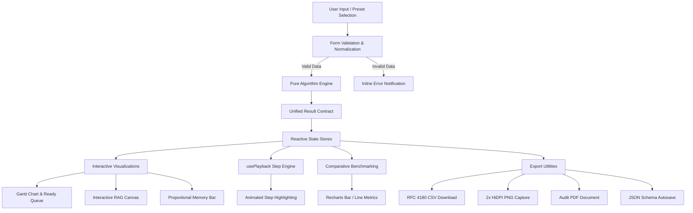

# OS Simulator Suite - Architectural Specification

## 1. Architectural Philosophy & Layered Design

The **OS Simulator Suite** is built with a strict four-layer decoupled architecture. Core algorithmic logic is completely separated from user interface rendering, enabling high maintainability, isolated unit testing, and straightforward academic extension.

```
+-------------------------------------------------------------+
| Layer 4: Page Modules & Layout Orchestrators                |
| (SchedulingPage.jsx, DeadlockPage.jsx, MemoryPage.jsx)      |
+-------------------------------------------------------------+
                              |
+-------------------------------------------------------------+
| Layer 3: Reusable UI & Visualization Components             |
| (GanttChart, RagCanvas, MemoryBar, AllocationTable, etc.)   |
+-------------------------------------------------------------+
                              |
+-------------------------------------------------------------+
| Layer 2: Custom React Hooks                                 |
| (usePlayback.js, useLocalStorage.js, useTheme.js)           |
+-------------------------------------------------------------+
                              |
+-------------------------------------------------------------+
| Layer 1: Pure OS Algorithms (Zero UI / React Dependencies)  |
| (src/algorithms/scheduling, deadlock, memory)               |
+-------------------------------------------------------------+
```

### Layer Breakdown

1. **Layer 1: Pure OS Algorithms (`src/algorithms/`)**
   - Pure ES modules with zero React or DOM dependencies.
   - Deterministic execution: identical inputs always produce identical outputs.
   - Comprehensive JSDoc annotations detailing time complexity, space complexity, tie-breaking rules, and academic references (Galvin/Silberschatz).
   - Fully testable in headless CI environments via Vitest.

2. **Layer 2: Custom React Hooks (`src/hooks/`)**
   - `usePlayback(totalSteps, options)`: Generic time-stepped animation engine providing Play/Pause/Step/Speed controls with timer cleanup. Reused across both CPU Timeline and Memory Allocation steps.
   - `useLocalStorage(key, initialValue, options)`: Debounced persistent state synchronization with versioned keys and defensive JSON parsing.
   - `useTheme()`: Manages dark/light theme switching with CSS variable token injection and OS preference detection.

3. **Layer 3: Visualization & Interactive Components (`src/components/`)**
   - Modular presentation units (under ~150 lines per file).
   - SVG and CSS-based responsive graphics (Gantt timelines, RAG directed graphs, proportional memory bars with hatched holes).
   - Recharts integration for comparative performance benchmarking.
   - Accessible keyboard controls and ARIA live regions for screen readers.

4. **Layer 4: Page Modules (`src/pages/`)**
   - High-level orchestrators that assemble algorithms, state hooks, form controls, and export utilities.
   - Wrapped inside `<ErrorBoundary>` components to isolate failures and guarantee zero application crashes.

---

## 2. Standardized Module Result Contracts

Every algorithm within a module conforms to a strict TypeScript-style JSDoc result contract. This uniformity allows visualization components to consume outputs polymorphically.

### CPU Scheduling Result Contract
All 8 scheduling algorithms (`fcfs`, `sjf`, `srtf`, `roundRobin`, `priorityNonPreemptive`, `priorityPreemptive`, `hrrn`, `mlfq`) return:
```javascript
{
  gantt: Array<{ pid: string, start: number, end: number, isIdle?: boolean }>,
  processes: Array<{
    pid: string,
    at: number,
    bt: number,
    priority?: number,
    ct: number,
    tat: number,
    wt: number,
    rt: number
  }>,
  timeline: Array<{
    time: number,
    running: string | null,
    readyQueue: string[],
    completed: string[]
  }>,
  log: Array<{ time: number, message: string }>,
  metrics: {
    avgTat: number,
    avgWt: number,
    avgRt: number,
    cpuUtilization: number,
    throughput: number,
    contextSwitches: number,
    starvationWarnings: string[]
  }
}
```

### Deadlock Module Result Contracts

#### Banker's Algorithm (`isSafe`)
```javascript
{
  isSafe: boolean,
  safeSequence: string[],
  trace: Array<{
    step: number,
    process: string,
    availableBefore: number[],
    need: number[],
    allocation: number[],
    availableAfter: number[]
  }>,
  work: number[],
  finish: boolean[]
}
```

#### Resource Allocation Graph (`analyzeDeadlock`)
```javascript
{
  hasDeadlock: boolean,
  isCycle: boolean,
  cycles: Array<Array<{ from: string, to: string, type: 'assignment'|'request' }>>,
  cycleNodes: string[],
  deadlockedProcesses: string[],
  details: string,
  reasons: string[]
}
```

### Memory Allocation Result Contract
All 3 contiguous allocation algorithms (`firstFit`, `bestFit`, `worstFit`) return:
```javascript
{
  allocations: Array<{
    pid: string,
    size: number,
    blockIndex: number | null
  }>,
  blocks: Array<{
    index: number,
    originalSize: number,
    remaining: number,
    allocatedTo: Array<{ pid: string, size: number }>
  }>,
  steps: Array<{
    pid: string,
    size: number,
    chosenBlock: number | null,
    candidates: Array<{ index: number, remaining: number, fits: boolean }>,
    note: string
  }>,
  stats: {
    internalFragmentation: number,
    externalFragmentation: number,
    unallocated: string[],
    utilizationPercent: number,
    totalMemory: number,
    usedMemory: number
  }
}
```

---

## 3. The Registry Pattern & Extensibility

Both CPU Scheduling and Memory Allocation leverage a **Central Registry Pattern** (`src/algorithms/scheduling/index.js` and `src/algorithms/memory/index.js`).

### How to Add a New Memory Algorithm (e.g., Next Fit) in 3 Steps:

1. **Implement Algorithm File** (`src/algorithms/memory/nextFit.js`):
   ```javascript
   import { validateMemoryInputs, normalizeInputs, computeStats } from './shared.js';

   export function nextFit(blocksInput, processesInput, options = {}) {
     const validation = validateMemoryInputs(blocksInput, processesInput);
     if (!validation.valid) throw new Error(validation.errors.join(' '));
     const { blocks, processes, mode } = normalizeInputs(blocksInput, processesInput, options);
     
     let lastAllocatedIdx = 0;
     const steps = [];
     const allocations = [];

     for (const p of processes) {
       // Search cyclically starting from lastAllocatedIdx...
     }

     const stats = computeStats(blocks, allocations, mode);
     return { allocations, blocks, steps, stats };
   }
   ```

2. **Register in Index** (`src/algorithms/memory/index.js`):
   ```javascript
   import { nextFit } from './nextFit.js';

   export const MEMORY_ALGORITHMS = {
     // ... existing
     nextFit: {
       id: 'nextFit',
       name: 'Next Fit',
       description: 'Resumes searching for free blocks from the location of the previous allocation.',
       pros: 'Faster than Best Fit; spreads allocations across memory.',
       cons: 'Can fragment memory near the end of the partition list.',
       complexity: 'O(N) search time',
       fn: nextFit,
     },
   };
   ```

3. **Done!** The UI dropdown, multi-algorithm comparison tables, Recharts benchmarks, and step-by-step playback automatically adapt without modifying a single line of component code.

---

## 4. End-to-End Simulation Data Flow


